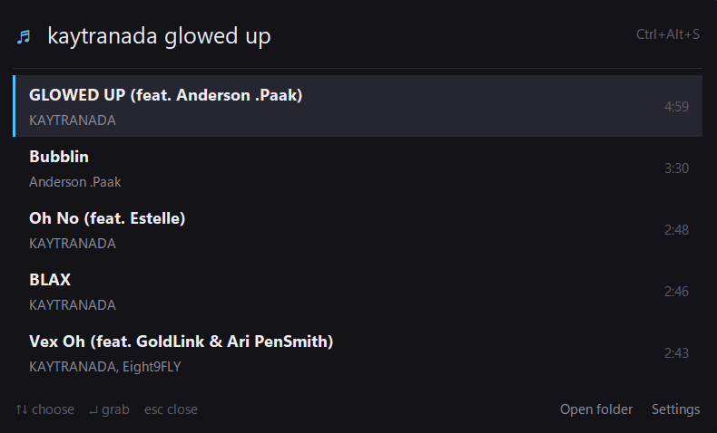
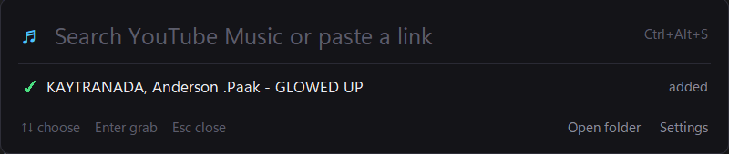

# rbgrab

rbgrab downloads songs from YouTube Music and puts them in a playlist you can open in rekordbox while you're DJing. Press Ctrl+Alt+S, type a song and hit Enter.



It stays in the tray and shows up to five results as you type, including remixes that were only uploaded as videos. If yt-dlp already saved a song to one of your music folders, the result is marked "✓ in library" and rbgrab won't download that video again. You don't need an account.

## Install

On Windows, paste this into PowerShell:

```powershell
irm https://raw.githubusercontent.com/neelb1/rbgrab/main/install.ps1 | iex
```

On an Apple Silicon Mac, paste this into Terminal:

```bash
curl -fsSL https://raw.githubusercontent.com/neelb1/rbgrab/main/install.sh | bash
```

The Mac version is a beta. The shortcut, menu bar icon and installer haven't been tested on a real Mac.

The installer also downloads [yt-dlp](https://github.com/yt-dlp/yt-dlp), plus ffmpeg if you don't have it. On Windows it all goes in your user folder and doesn't need admin rights. On a Mac with Homebrew, ffmpeg is installed through Homebrew.

rbgrab starts when you log in unless you turn that off in Settings. To uninstall, run the same command with `uninstall.ps1` or `uninstall.sh`. Your downloaded music stays where it is.

## Set up rekordbox

You only have to do this once. The window that opens on first launch has the same steps.

1. In rekordbox, go to Preferences > Advanced > Database > rekordbox xml and choose the `rekordbox.xml` in your rbgrab download folder. The setup window has a "Copy path" button for it.
2. Go to Preferences > View > Layout and tick "rekordbox xml".
3. New songs show up under rekordbox xml > Playlists > rbgrab. Click the refresh icon to load them, then drag one to a deck.

## Using it

| Key | What it does |
|---|---|
| `Ctrl+Alt+S` (Mac: `⌃⌥S`) | Opens or closes the search bar |
| `↑` `↓` or the mouse | Picks a result |
| `Enter` | Grabs the selected result, or the top match if results are still loading |
| `Esc` | Closes the bar |

Paste a YouTube or YouTube Music link to grab that exact video. You can have several downloads going at once, and the bar shows their progress.



With the bar closed, a small popup in the corner tells you when a song is ready, already in your library, or failed. On Windows it doesn't take keyboard focus away from rekordbox.

Settings is in the tray icon's menu. You can change the shortcut, download folder, playlist name and format there (M4A as downloaded, or MP3 320), add music folders to check for songs you already have, and choose whether rbgrab starts at login or hides the bar after a grab.

## How it works

Search uses [ytmusicapi](https://github.com/sigma67/ytmusicapi). Results are ranked by how many of your words they match, and songs go ahead of videos when they tie.

Downloads use the standalone yt-dlp program. YouTube changes often, so the installed app checks for a yt-dlp update every week. There's also an "Update yt-dlp" button in Settings.

rbgrab doesn't touch rekordbox's database. It writes `rekordbox.xml`, and rekordbox imports from that.

The shortcut uses Win32 `RegisterHotKey` on Windows and `pynput` on Mac, where you have to allow Input Monitoring.

## Run from source

```bash
git clone https://github.com/neelb1/rbgrab && cd rbgrab
pip install -e ".[dev]"
python -m rbgrab        # needs ffmpeg on PATH
pytest
```

A source install also lets you grab a song without opening the bar: `rbgrab "artist song"`.

Build the app with `python -m rbgrab.icon assets/icon.png && pyinstaller rbgrab.spec`. Pushing a `v*` tag builds the Windows and Mac releases on GitHub Actions.

Issues and PRs are welcome. The goal is to keep rbgrab small.

## Personal use

rbgrab is for things like practising, trying out ideas, or grabbing a request at a house party. Downloading from YouTube may break its Terms of Service, and the audio is lower quality than a file you'd buy. Buy the tracks you play out.

rbgrab isn't affiliated with AlphaTheta, Pioneer DJ or YouTube.

## License

MIT. The release builds include other open-source libraries, listed in [THIRD_PARTY.md](THIRD_PARTY.md). They don't include yt-dlp or ffmpeg, which the installer downloads separately.
